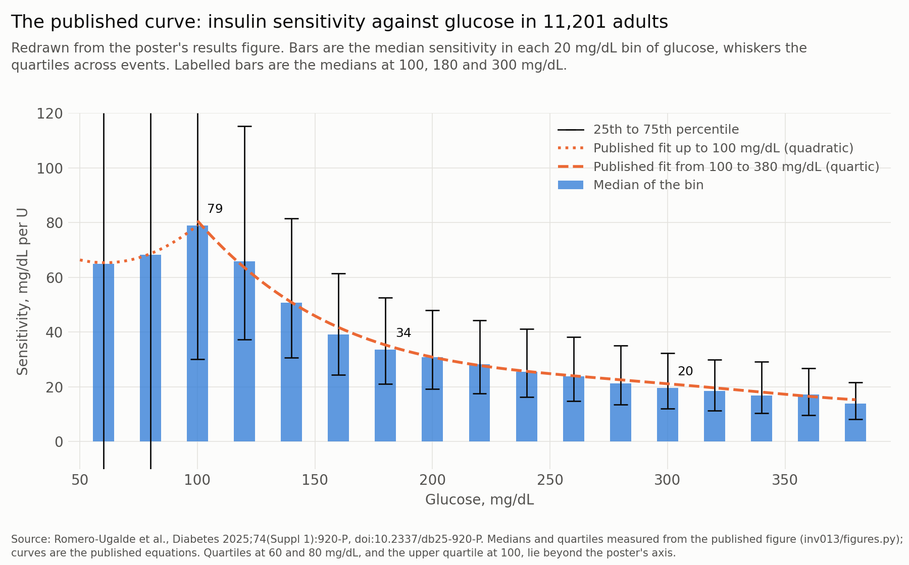
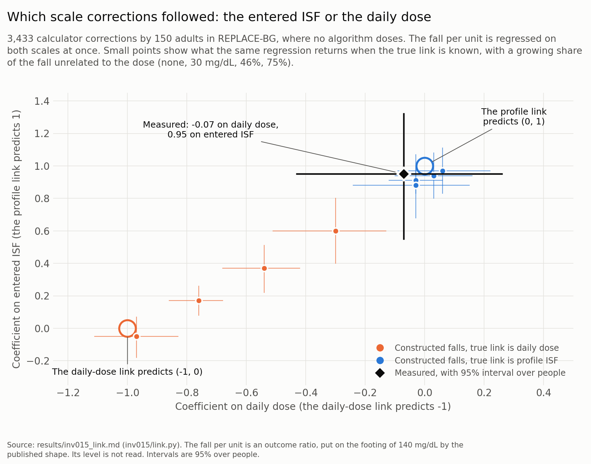
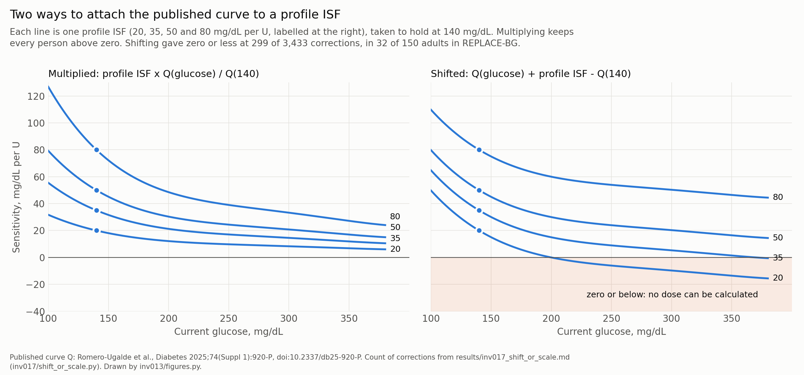
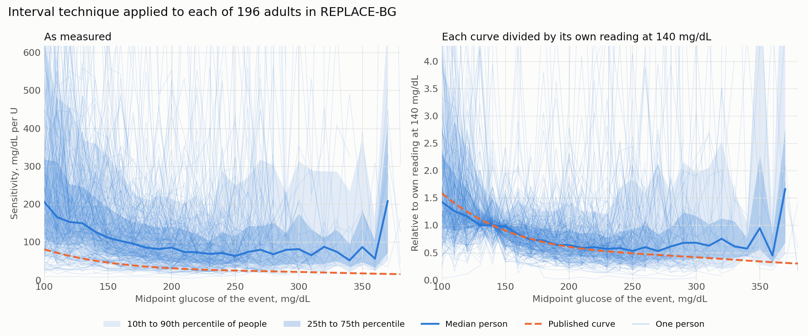
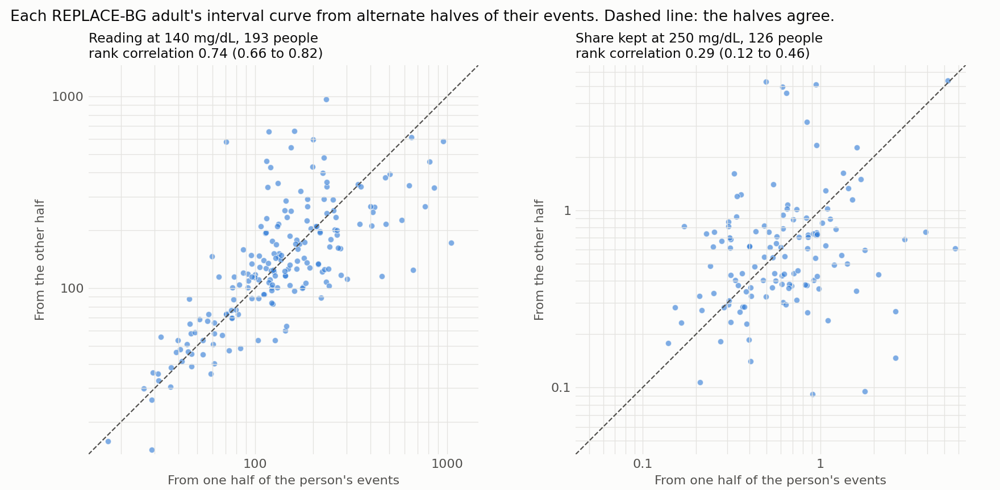
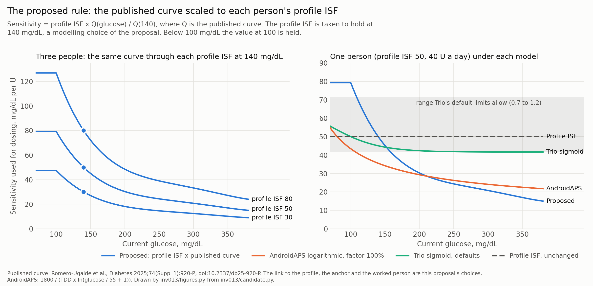
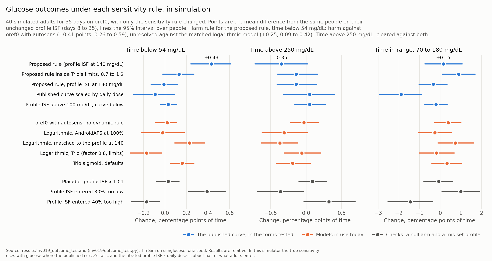

## Summary

The dynamic ISF models in AndroidAPS and Trio have two origins. The logarithmic
model began with Chris Wilson, who described the work in a talk to Loop and Learn
in February 2022 [2]. Through an online form he asked volunteers from the diabetes
online community what correction dose they would give at a stated glucose, with
glucose steady and no insulin on board. About 50 people answered, from a
two-year-old using 8 U a day to people in their seventies using more than 100 U,
and the usable answers gave about 300 data points. The doses and their effects were
reported by the respondents from experience, and neither was measured. He trained a neural network on those points and
gave the surface it found across glucose and TDD as roughly 277,700 ÷ (glucose ×
TDD). AndroidAPS first carried that equation, from February 2022, and the glucose
term was replaced by a logarithm in June 2022, which is the form in use now [3].
The talk predates that change and does not describe it.

The sigmoid model offered in Trio came from its author's observation of glucose
response, and no analysis of data has been published in support of it.

Diabeloop has since examined the same idea on the records of its own closed-loop
system and presented the result at the American Diabetes Association's Scientific
Sessions in 2025 [1]. From 11,201 adults it reported a sensitivity of 79 mg/dL per
unit at a glucose of 100 mg/dL, 35 at 180 and below 20 above 300, with a fitted
equation.

This document builds on that work. It sets out the equation and how it was
derived, and reports what the same measurement shows on other cohorts. It then
describes how the equation could be offered in AndroidAPS and Trio as an
alternative to both the logarithmic and the sigmoid models.

The measurement was repeated on 1,790 people in eight cohorts held in this series.
Within person, the value at 100 mg/dL was 2.2 to 4.0 times the value at 200,
against 2.61 in the published equation, so the steep fall towards 200 mg/dL is
reproducible. On records where no algorithm was dosing, the published equation
fits the measured values from 100 to 200 mg/dL at a single scale. On Loop records
no single scale fits. Refitting the equation's five coefficients to each cohort
agreed with both results, and returned a flatter curve than the published one
above 200 mg/dL.

The measurement was also run on simulated people whose true sensitivity was
known, and those runs are reported in full below. They describe how the
measurement behaves. This document takes the published equation as given and asks
how it should be scaled to a person and offered in the two systems.

The published equation has no term for the person, and it needs one before it can
dose. Two are described here: the profile ISF, and total daily dose (TDD) as the
logarithmic model uses. They were compared on 3,433 corrections given by 150
adults in a trial where no algorithm was dosing. The fall in glucose per unit
followed the person's entered ISF, with a coefficient of 0.95 (95% interval 0.55
to 1.32) where the profile link predicts 1. Daily dose added nothing once the
entered ISF was known, at -0.07 (-0.43 to 0.26) where the TDD link predicts -1.
The link to the profile is therefore the candidate, and the link to TDD is kept
as an arm of the evaluation.

The curve is fitted to a person by taking their profile ISF to be valid at one
glucose and scaling the whole published curve to pass through it. That glucose is
140 mg/dL in this proposal, which is a modelling choice and open to revision. The
publication's own reference is 180 mg/dL, and anchoring there would make every
dose 1.44 times smaller. For an adult on 40 U a day with a profile ISF of 50 mg/dL
per unit, the candidate gives 79.3 mg/dL per unit at 100 mg/dL, 50.0 at 140 and
30.3 at 200. AndroidAPS at an adjustment factor of 100% gives that person 43.4,
35.6 and 29.3. Both links are modelling choices made in this document and appear
nowhere in the publication.

Multiplying gives every person the published shape, and two checks reported below
support doing so. Attaching the curve by adding a constant in place of multiplying
gave a sensitivity of zero or below at 299 of the 3,433 corrections. A curve
measured separately for each person had a shape that predicted that person's
other events no better than the shape shared by everyone, in each of six cohorts.

The ends of the curve sit outside Trio's default limits. Trio holds a dynamic ISF
between the profile ISF divided by 1.2 and the profile ISF divided by 0.7. The
candidate stays inside that band only between 109 and 158 mg/dL. Below 109 mg/dL
it gives a higher sensitivity than Trio allows, reaching 1.59 times the profile
ISF at 100 mg/dL against a ceiling of 1.43. Above 158 mg/dL it gives a lower one,
reaching 0.30 times the profile ISF at 380 mg/dL against a floor of 0.83. With the
limits unchanged, Trio would dose from the curve over 49 of the 280 mg/dL it
covers. The limits need a decision from Trio's maintainers before the model can
run there as published. AndroidAPS applies no such limit in its dynamic ISF
calculation.

The candidate has since been run in simulation (INV-019). Forty simulated adults
were run for 35 days in TimSim with shipped oref0 dosing, and only the sensitivity
rule differed between arms. Against the same people on their unchanged profile,
the candidate lowered mean glucose by 1.8 mg/dL (95% interval 0.7 to 2.9) and
raised time below 54 mg/dL by 0.43 percentage points (0.24 to 0.61), which is
about what a profile ISF entered 30% too low did. A harm rule written before the
run read harm on the low side against oref0 with autosens. It read unresolved
against a logarithmic model matched to the profile, and cleared on the high side
against both. Held inside Trio's default limits, the candidate raised time below
54 mg/dL by 0.13 points (-0.02 to 0.27) and time in range by 0.90 points (0.11 to
1.69). The simulated body is built the opposite way to the equation's premise,
since a unit of insulin does more there as glucose rises. The run therefore ranks
the rules in that simulator, and its sizes are not estimates for people. The harm
reading is reported and looked into, and it does not stop the candidate from
moving to shadow running.

Two things are unsettled. The first is how far the comparison of links reaches. It
covers adults on a pump who gave their own corrections, and it compares people
with each other, so it does not show whether one person's value should also move
with their recent insulin use, as the TDD link does. People using a loop were not
tested, and nor were children. The second is whether a loop dosing to this
equation does better in people than one dosing to either existing model. The
simulation is the only test so far, and nothing has been tested in people.

This is a draft for discussion. The equation has not run on a device, and the
candidate uses the published coefficients unchanged. Readers are assumed to
know how dynamic ISF works in both systems. Glucose is in mg/dL throughout because
the code is.

## What is the Diabeloop equation?

The source [1] is a conference abstract and poster from Diabeloop, the maker of
the DBLG1 closed-loop system. It used the records of 11,201 adults with type 1
diabetes from March 2021 onwards. No full paper was found.

The abstract reports a sensitivity that rises from 65 to 79 mg/dL per unit between
50 and 100 mg/dL. Above that it falls, to 35 at 180 mg/dL and below 20 above 300.
Relative to a dose sized at 180 mg/dL, the authors suggest the dose could be halved
at 120 mg/dL or below and may need doubling above 340.

The poster's results figure gives the fit in two pieces, for glucose G in mg/dL.
Up to 100 mg/dL:

`ISF = 98.03 - 1.077 G + 0.008868 G^2`

Above 100 and up to 380 mg/dL:

`ISF = 272 - 3.121 G + 0.01511 G^2 - 3.305e-05 G^3 + 2.69e-08 G^4`

The coefficients in the code (`inv008.dynisf.quartic_isf`) were checked against
that figure on 11 November 2026 and match digit for digit. The quartic gives 80.6
mg/dL per unit at 100 mg/dL, 35.3 at 180, 21.1 at 300 and 15.3 at 380. It implies
dose multiples of 0.56 at 120 mg/dL and 1.95 at 340, in line with the abstract's
half and double. The quadratic gives 79.0 at 100 mg/dL and 65.3 at 60, so the two
pieces differ by 2% where they meet.

The figure below redraws the poster's results figure. The poster gives its bin
medians and quartiles only as a drawing, so they were measured from the image, and
the measured medians sit within 2.6 mg/dL per unit of the published equations
(`results/inv013_poster_figure.md`).

The equation is steeper than the logarithmic model. Between 100 and 200 mg/dL its
value falls by a factor of 2.61, where the logarithmic model with a divisor of 55
falls by 1.48. From 200 to 300 mg/dL its value is multiplied by 0.69 and the
logarithmic model's by 0.82.

It has no term for the person. Everyone gets 35.3 mg/dL per unit at 180 mg/dL,
whatever their daily dose or their profile.

## How was it derived?

The unit of analysis is a fall in glucose. On days with at least 75% of time in
closed loop, the authors took each glucose peak between 50 and 400 mg/dL that came
at least an hour after a meal, with less than 2.5 g of carbohydrate still on
board, and followed it to the next minimum more than 20 minutes later. The
sensitivity for the event is the fall divided by the insulin used over it. Insulin
used is the drop in insulin on board plus whatever was delivered above the
reference basal. The curve is the fit through those event values against glucose.

Each event ends where glucose stopped falling, so events are selected on what
glucose did. The figure is therefore a ratio of two outcomes, the fall and the
insulin used during it. The events are how the variation of sensitivity with
glucose was measured. The proposal uses the equation fitted through them, applied
at the current glucose.

Four things the derivation depends on are absent from the publication. It does not
define the reference basal or say which insulin action model produced the insulin
on board. The figure's horizontal axis is labelled G(t) with no statement of which
glucose in an event that is. It gives no daily dose for the people measured. The
rest of the poster could not be retrieved, and the authors have not been asked.

## What does it show on our data?

The same construction was run in this series as INV-012, on 1,790 people in eight
cohorts, and is reported in section 7 of document 5. It was built before the
abstract was read, and two of its event rules differ from the published ones. It
required three hours clear of a meal where the publication requires one hour with
under 2.5 g on board, and a peak standing 15 mg/dL clear of its surroundings where
the publication requires a 20 minute interval. Each event was filed under the
glucose halfway between its peak and its minimum, and multiplied by the person's
daily dose.

### The shape between 100 and 200 mg/dL

The steep fall is reproducible. Within person, the value at 100 mg/dL was 2.2 to
4.0 times the value at 200 mg/dL across the eight cohorts, against 2.61 in the
published equation. In REPLACE-BG, where no algorithm was dosing, the ratio was
2.55 (95% interval 2.25 to 2.82), which includes the published figure. Under
closed loop it was steeper: 3.26 (3.11 to 3.39) for Loop, 3.86 (2.72 to 6.04) for
oref0 and 3.21 (2.24 to 5.62) for Trio. The first two intervals lie above 2.61 and
Trio's includes it.

### Fitting the equation to the measured values

The table divides the measured value in each glucose bin by the published value at
that glucose. The result is the daily dose, in U, at which the published equation
would return what was measured. A row that stays level means the published shape
fits that cohort at one scale. Only the four cohorts with carbohydrate records are
shown, with the 95% interval over people.

| Cohort | People | 100 mg/dL | 150 | 200 | 250 | 300 |
|---|---:|---:|---:|---:|---:|---:|
| No algorithm (REPLACE-BG) | 196 | 103 (89 to 115) | 100 (94 to 108) | 106 (94 to 125) | 120 (103 to 137) | 174 (132 to 233) |
| Loop | 842 | 88 (84 to 91) | 58 (56 to 60) | 71 (67 to 73) | 82 (77 to 89) | 108 (95 to 119) |
| Trio | 22 | 90 (63 to 111) | 52 (40 to 64) | 74 (51 to 104) | | |
| oref0 | 86 | 109 (90 to 136) | 70 (59 to 86) | 78 (58 to 188) | | |

With no algorithm dosing, the published equation fits from 100 to 200 mg/dL at one
scale: 103, 100 and 106 U, each inside the other two intervals. Above 200 mg/dL
the row rises to 120 and then 174 U, so the published equation falls faster there
than these records do. Under Loop no single scale fits. The figure is 88 U at 100
mg/dL, 58 at 150 and 71 at 200, and those three intervals do not overlap. Trio and
oref0 show the same dip at 150 mg/dL with wider intervals.

Two cautions apply to the table. The columns hold different people, since fewer
reach the higher bins, and the within-person ratios in this section are the firmer
comparison. The published values were read at the centre of each bin on the
assumption that the publication files an event under its midpoint glucose, which
it does not state.

The scale itself is not a daily dose anyone was using. It is about 100 U in
REPLACE-BG because the measurement reads high where no algorithm doses, as the
simulations below show.

### Refitting the equation

The equation was also refitted. The quartic, with all five coefficients free, was
fitted to each cohort's values in 10 mg/dL bins, from 100 mg/dL to the highest bin
holding ten people. Each bin was weighted by the square root of the people in it,
which is a modelling choice, since the poster does not state its weighting. For
comparison the published fit was laid over the same bins with one free number, its
scale in U. The miss is the typical distance between a fit and the bin values, as
a percentage of each value.

| Cohort | People | Bins fitted, mg/dL | Best scale of the published fit, U | Miss, published fit | Miss, refit |
|---|---:|---|---:|---:|---:|
| No algorithm (REPLACE-BG) | 196 | 100 to 370 | 103 (96 to 113) | 14% | 7% |
| Loop | 842 | 100 to 380 | 71 (69 to 74) | 17% | 6% |
| Trio | 22 | 100 to 200 | 65 (48 to 80) | 18% | 7% |
| oref0 | 86 | 100 to 240 | 82 (71 to 99) | 23% | 14% |

The refit misses by less in every cohort, as a fit with four more free numbers
must. The second table shows where the two differ. It gives each fit relative to
its own value at 180 mg/dL.

| Fit | People | 100 mg/dL | 150 | 200 | 250 | 300 |
|---|---:|---:|---:|---:|---:|---:|
| Published | | 2.29 | 1.30 | 0.87 | 0.70 | 0.60 |
| Refit, no algorithm (REPLACE-BG) | 196 | 2.17 (1.91 to 2.40) | 1.28 (1.21 to 1.33) | 0.89 (0.86 to 0.92) | 0.81 (0.72 to 0.87) | 0.90 (0.77 to 1.02) |
| Refit, Loop | 842 | 3.19 (3.02 to 3.34) | 1.25 (1.22 to 1.27) | 1.00 (0.98 to 1.01) | 1.07 (1.03 to 1.11) | 0.94 (0.88 to 1.01) |
| Refit, Trio | 22 | 3.29 (2.15 to 4.76) | 1.19 (0.85 to 1.53) | 1.12 (0.66 to 1.61) | | |
| Refit, oref0 | 86 | 2.96 (2.22 to 3.83) | 1.00 (0.78 to 1.24) | 1.02 (0.82 to 1.38) | | |

With no algorithm dosing, the refit returns the published shape from 100 to 200
mg/dL, and all three intervals there include the published figure. At 250 and 300
mg/dL the refit sits at 0.81 and 0.90 of its value at 180, where the published fit
is at 0.70 and 0.60. Both of those intervals exclude the published figure. Under
Loop the refit differs from the published fit at every glucose in the table. It is
higher at 100 mg/dL, 3.19 against 2.29, and from 200 mg/dL upward it stays close
to its value at 180. Trio's intervals, from 22 people, include the published
figure at each of its three points. The oref0 values resemble Loop's, with an
interval that excludes the published figure only at 150 mg/dL.

Two limits apply. A quartic suits these records poorly, because the values fall
steeply to about 150 mg/dL and then level off. Under Loop the refit rises from
1.00 to 1.07 between 200 and 250 mg/dL, while the bin values themselves go from
2,182 to 2,025. Above 200 mg/dL the bins and the within-person ratios reported
below are the better guide. The second limit is that the refit describes the same
outcome ratio as the published curve, so the simulations in the next subsection
bear on it equally.

The refit gives no single equation to offer in place of the published one. Its
coefficients differ between cohorts, and its value at 180 mg/dL is 3,657 (3,431 to
4,055) with no algorithm dosing and 2,123 (2,048 to 2,214) under Loop. It confirms
the published shape between 100 and 200 mg/dL on records that no loop shaped. It
also agrees with the within-person ratios that, by this measure, the published
fall above 200 mg/dL is not reproduced here.

### What the method returns when the truth is known

The method has been run twice on simulated people whose true sensitivity was
known.

In the first run (INV-012) the sensitivity was constant at every glucose, 2,000
when multiplied by daily dose, and 45% of meals went unlogged. Two arms were dosed
by a simple reactive loop, at a tenth and at a fifth of its gain. They returned
values 1.4 to 3.4 times too high, declining as glucose rose. Their ratio of the
value at 250 to the value at 200 mg/dL was 0.87 (0.83 to 0.90) in one arm and 0.92
(0.89 to 0.95) in the other. The same loop at full gain returned 1,816 and 1,520
at 150 and 200 mg/dL, below the true value, and reached no higher bin. An arm with
no loop returned 4,560, 4,509 and 6,091 at 150, 200 and 250 mg/dL. Its ratio was
1.31 (1.00 to 1.94), from 25 people, so it read high and did not fall. A constant
sensitivity therefore returned a falling curve in the arms where a loop was
dosing, and in the arm with none it did not.

The six Jaeb cohorts gave 0.84 to 1.05 for the same ratio, a range that contains
both reduced-gain arms, so the decline in those cohorts between 150 and 250 mg/dL
needs no change in what a unit of insulin does to explain it. The published
equation gives 0.80, which is steeper than either arm by an amount this series
cannot account for. At 100 mg/dL between 59 and 93% of the simulated events had no
net insulin used, and no arm gave a value at 300 mg/dL, so the first run says
nothing about either end.

The second run (INV-014) was made to cover those ends. It used TimSim, which runs
the UVA/Padova model of glucose and insulin [4, 5] with added layers for
day-to-day physiology, behaviour, the sensor and the infusion site. That model has no single sensitivity,
so the truth was measured before the method was read. Each of 40 simulated adults
was held fasting at twelve steady glucose levels, and at each a small bolus was
given in one of two otherwise identical runs. The true sensitivity at that glucose
is the largest gap that opened between the two, per unit given. A unit lowered
glucose by 11.1 mg/dL (10.1 to 13.7) at 100 mg/dL, from 39 people, by 23.0 (16.8
to 25.9) at 200, from 39, and by 34.6 (32.0 to 51.0) at 300, from 24. Within
person the value at 100 mg/dL was 0.52 (0.49 to 0.54) of the value at 200, and the
value at 300 was 1.30 (1.25 to 1.34) of it. In this simulator a unit of insulin
does more at higher glucose. That is a property of the model in a fasting steady
state and is no evidence about people.

The same people then lived 56 simulated days under each of five dosing regimes.
Two ran oref0 with SMB, one with the simulator's infusion-site faults and one
without them. Two had no algorithm and gave corrections by hand: scheduled basal
and a bolus for each announced meal, with a full correction towards 140 mg/dL
whenever the sensor read above 180 mg/dL, at most once in three hours. Those two
differed over site faults in the same way. The fifth had scheduled basal and meal
boluses, with no corrections between meals. The correction rule is a modelling
choice and was not fitted to anything.

The method was run on what a real record would hold, so unannounced meals and
rescue carbohydrate were absent from it. Events were filed in bins 50 mg/dL wide,
where the cohorts above used 10, because 56 days gave too few events for narrower
ones. Of the 40 people, 31 completed every regime, and the table uses those 31. It
gives the method's value divided by the truth, within person, and then the ratio
of the value at 100 mg/dL to the value at 200 by the method and in truth.

| Regime | Method ÷ truth at 100 mg/dL | At 150 | At 200 | 100:200 by the method | 100:200 in truth | People with both bins |
|---|---:|---:|---:|---:|---:|---:|
| oref0 with SMB | 4.29 (3.83 to 4.50) | 1.28 (1.19 to 1.40) | 0.62 (0.53 to 0.73) | 3.62 (3.06 to 4.30) | 0.53 (0.49 to 0.55) | 28 |
| oref0 with SMB, no site faults | 4.27 (4.02 to 4.61) | 1.40 (1.27 to 1.51) | 1.15 (0.84 to 1.24) | 1.98 (1.61 to 3.02) | 0.50 (0.47 to 0.61) | 11 |
| Corrections by hand | 15.55 (13.47 to 20.00) | 4.71 (4.00 to 5.21) | 1.69 (1.35 to 1.85) | 4.85 (3.92 to 6.67) | 0.52 (0.49 to 0.54) | 29 |
| Corrections by hand, no site faults | 17.94 (16.67 to 20.06) | 5.00 (4.26 to 5.76) | 1.88 (1.72 to 2.28) | 4.64 (4.33 to 5.70) | 0.52 (0.49 to 0.54) | 29 |
| Meal boluses only | 14.90 (11.62 to 16.70) | 16.00 (12.72 to 19.59) | 28.18 (17.33 to 70.38) | 0.24 (0.10 to 0.45) | 0.52 (0.49 to 0.54) | 29 |

In the four regimes that gave corrections, the method's value at 100 mg/dL was 2.0
to 4.9 times its value at 200, and every interval lies above 1. The truth ran the
other way, at about half. The real cohorts gave 2.2 to 4.0 and the published
equation gives 2.61, so the simulator returned the published shape between 100 and
200 mg/dL from a sensitivity that rose with glucose. The arithmetic behind it is
the same as in the real records, described under "Near target" below. Under oref0
the median fall was 32 mg/dL for events at 100 mg/dL and 41 for events at 200,
while the median insulin used rose from 0.63 to 3.88 U.

The table's values are medians over events with positive insulin used, as on the
cohorts. Under oref0, 6 to 7% of events at 100 mg/dL had no net insulin used and
none did at 150 or 200. With corrections by hand the share was 32 to 40% at 100
and 150 mg/dL and nil at 200.

With meal boluses only, the method's curve rose with glucose. From 150 mg/dL
upward the median event in that regime had no net insulin used, and 66 to 77% of
events had none. Its values rest on the remaining events, whose doses were near
zero, and they ran from 15 times the truth at 100 mg/dL to several thousand times
it at 300. The arm with no loop in the first run behaved in the same way. Across
both runs the curve fell where insulin was given in response to high glucose and
did not fall where it was not, whatever the true sensitivity did.

The level was wrong in both directions. Under oref0 the method read 4.29 times the
truth at 100 mg/dL and 0.62 of it at 200.

Above 200 mg/dL the check is thin. In the regimes with corrections the middle
90% of a typical person's sensor readings lay between 78 and 241 mg/dL. One of them, corrections by hand
with site faults, held ten people at 250 mg/dL. There the method's value was 0.83
(0.75 to 1.07) of its value at 200, from 17 people, where the truth was 1.16 (1.13
to 1.22) of it. No regime with corrections filled a bin at 300 mg/dL.

Four limits apply to the second run. TimSim's own audit records that its
validation figures predate a rebuild, so it is not described here as validated.
The run shows what the method returns from a known truth and says nothing about
what the truth is in people. The truth was measured fasting with the added layers
off, and a free-living high usually has carbohydrate still absorbing and more
insulin on board. A truth measured inside the free-living runs was not attempted.
The bins are five times wider than those used on the cohorts. The nine people left
out each had a run that ended early, so the 31 are selected on having completed.
Nine runs ended through hypoglycaemia, eight of them under oref0, and four through
hyperglycaemia, all with meal boluses only.

### Near target

Near target the decline comes from the insulin, with the fall almost unchanged.
Across cohorts the median fall was 30 to 43 mg/dL for events at 100 mg/dL and 39
to 64 for events at 200. The median insulin used was 0.02 to 0.2 U at 100 mg/dL
and 0.3 to 1.5 U at 200. A similar fall divided by much less insulin gives a much
higher figure. At 100 mg/dL between 9 and 58% of events had no net insulin used at
all, and a line fitted through each person's events put the fall at zero net
insulin at 27 to 44 mg/dL. In type 1 diabetes a raised glucose does not fall
without insulin, so that fall is basal and earlier doses acting, together with the
selection of events that end at a minimum. The steep part of the curve below 150
mg/dL therefore rests on very small net doses. The second simulation showed the
same pattern, and there the value at 100 mg/dL was 4.3 to 17.9 times the truth.

### Above 200 mg/dL

The two measures disagree here. By the ratio of fall to insulin used, the value at
300 against 200 mg/dL within person was 0.90 (0.77 to 1.26) in REPLACE-BG, from 60
people, and 0.96 (0.84 to 1.08) under Loop, from 137 people. Both intervals
exclude the published 0.69. Measured as the extra fall per extra unit, the same
comparison gave 0.66 (0.49 to 0.73) in REPLACE-BG, from 24 people, and 0.73 (0.64
to 0.93) under Loop, from 49 people, and both of those include 0.69. No
simulated regime with corrections reached 300 mg/dL, so neither measure has a
known-truth check there. The extra fall per extra unit was not computed in the
second simulation.

### As a predictor

The shape has been tried once as a predictor on oref records, where it did worse
than the static profile. On 80 people and 62,344 overnight windows, with each
shape anchored to the profile at 100 mg/dL, the typical miss was 24.2 mg/dL for
the static profile and 29.8 for this shape. At 205 to 260 mg/dL it was 37.8
against 73.7. No interval was reported for those figures. Two things limit the
test. Its windows were selected on the later outcome, as the audit of 16 September
2026 recorded, and it anchored the shape at 100 mg/dL where this document anchors
at 140.

### Where that leaves the equation

The publication is a conference abstract from the system's manufacturer, drawn
from the records of 11,201 adults, and this document takes its equation as given.
The same measurement on other people's records reproduces it between 100 and 200
mg/dL. Above 200 mg/dL the records here are flatter than the published fit by one
measure and agree with it by the other.

The simulations describe how the measurement behaves on constructed records. They
say nothing about what the truth is in people, and they are reported so that a
reader can weigh them.

Two questions remain for this series. One is the scale for each person, taken up
in the next section. The other is whether a loop that doses to the equation does
better than one dosing to either existing model or to a flat profile. The third
stage of the evaluation below ran that comparison in simulation, and it has not
been tested in people.

A proposal from June 2026 that used this shape (document 3) was withdrawn for live
dosing on 16 September 2026. The audit of that date left the way open for such
candidates to be simulated and replayed in shadow, and to be studied
prospectively. The evaluation proposed below stays inside that.

## How could it be implemented?

### What it would replace

AndroidAPS and Trio run the same logarithmic equation:

sensitivity = 1800 ÷ (adjustment factor × TDD × ln(glucose ÷ divisor + 1))

Trio computes a ratio, profile ISF × adjustment factor × TDD × ln(glucose ÷ divisor
+ 1) ÷ 1800, and divides the profile ISF by it, so the profile value cancels. Given
the same inputs the two systems return the same number. This was checked on 11 November 2026 against AndroidAPS dev 0c593a4b09 and
Trio dev 902be75e8, both of 10 November 2026. Neither calculation differs from the
released versions (AndroidAPS master f77abd9b82, Trio main 0b29cd534), and Trio's
`DynamicISF.swift` was last changed on 24 August 2026.

What separates the two in use is the defaults around the equation. Trio's
adjustment factor defaults to 0.8 where AndroidAPS defaults to 100%, which puts
Trio's value 25% higher. Trio then holds its ratio inside the autosens limits, 0.7
and 1.2 by default, and `calculateRawDynIsf` in AndroidAPS applies no limit. For
the worked person Trio's upper limit binds from 157 mg/dL. Above that glucose its
value stays at 41.7 mg/dL per unit while AndroidAPS continues down to 29.3 at 200
mg/dL. The daily dose is blended differently in each system, and the divisors
differ for faster insulins: 55, 65 or 75 by peak time in AndroidAPS, and 55 or 70
in Trio, or 120 less a custom peak time.

Trio's sigmoid mode returns the profile ISF at the profile target and moves it
within the same limits. oref0 as published has autosens and no dynamic ISF based
on daily dose. Loop and iAPS were not read.

### Linked to the profile ISF, or to TDD?

The published values need a scale for each person. At 140 mg/dL the equation gives
50.9 mg/dL per unit to a person on 20 U a day and to a person on 80 U a day. Among
422 adults with entered pump settings analysed earlier in this series, sensitivity
multiplied by daily dose was 1915 (95% CI 1828 to 1986), which puts the first of
those people near 96 mg/dL per unit and the second near 24.

The approach is to titrate the curve to the person. Their entered setting is taken
to be valid at one glucose, the anchor, and the whole published curve is
multiplied by the one number that makes it pass through that value. The shape is
left as published. The curve moves up or down for each person, and the ratio
between its values at any two glucose levels stays as published.

The anchor in this proposal is 140 mg/dL. That is a modelling choice, made as the
initial proposal, and nothing in the publication or in the analyses here selects
it. The publication's own reference point is 180 mg/dL, the glucose against which
it states its halving and doubling of doses, and earlier drafts of this document
anchored there. The published value at 140 mg/dL is 1.44 times the value at 180.
Anchoring at 140 therefore gives every person a sensitivity 1.44 times lower at
every glucose than anchoring at 180 would, and a dose 1.44 times larger.

Linked to the profile, the entered ISF is taken to hold at 140 mg/dL:

sensitivity = profile ISF × (published value at this glucose ÷ published value at 140 mg/dL)

This fits Trio's structure, which already expresses dynamic ISF as a ratio of the
profile. The schedule through the day is kept and no level has to be chosen. The
value does not respond to recent dosing. It is also only as good as the entered
number. It suits a profile ISF the person has evaluated, and it carries the whole
of any error in one they have not.

Linked to TDD, a person's sensitivity at 140 mg/dL is taken to be 1915 ÷ TDD:

sensitivity = (1915 ÷ TDD) × (published value at this glucose ÷ published value at 140 mg/dL)

This is the logarithmic model with its glucose term swapped. The daily dose is
each system's existing blend and the adjustment factor multiplies it as now. The
divisor for insulin type has no counterpart and drops out. The value keeps moving
with recent insulin use by the same multiplier as today: 1.39 for a person whose
blended dose is 0.72 of their own average and 0.88 at 1.14 of it, which are the
tenth and ninetieth percentiles among 960 people in document 6. The profile ISF
and its schedule through the day play no part, as in AndroidAPS now. The adult
figure of 1915 is a modelling choice. The figure pooled across all ages in the
same analysis is higher, and 51% of that group are children, so it was not used.

The two links agree for anyone whose profile ISF multiplied by daily dose is 1915.
They differ for everyone else, and that difference was used to test them.

### Which link corrections followed

The test (INV-015) used REPLACE-BG, the one cohort here in which a correction was
the person's own dose and no algorithm added to it. A correction counted when it
was given at 150 to 350 mg/dL and was at least 0.5 U, with no carbohydrate entered
for six hours either side and no further bolus for six hours. That left 3,433
corrections from 150 adults who each had five or more. Among them the entered ISF
multiplied by daily dose had a median of 1929. A tenth of people sat below 1345
and a tenth above 2997, and that spread is what separates the links.

For each person the fall in glucose over six hours, per unit given, was divided
by the published shape at the starting glucose, and the median was taken. That
figure is a ratio of outcomes and only its ordering of people was used. It was
related to daily dose and to the entered ISF together, in logarithms. The
expectation written before the run was that the result would lean towards the
profile.

| | Coefficient on daily dose | Coefficient on entered ISF |
|---|---:|---:|
| The link to TDD predicts | -1 | 0 |
| The link to the profile predicts | 0 | 1 |
| Measured (95% interval) | -0.07 (-0.43 to 0.26) | 0.95 (0.55 to 1.32) |

Both measured intervals include what the link to the profile predicts and exclude
what the link to TDD predicts.

The second table puts the same people in four groups of equal size by their
entered ISF multiplied by daily dose. The first group entered an ISF well below
what their daily dose would suggest, and the last group one well above it. The
last column is the fall achieved per unit as a multiple of the entered ISF.

| Entered ISF × daily dose | People | Start, mg/dL | Target | At six hours | Achieved ÷ entered ISF (95% interval) |
|---|---:|---:|---:|---:|---:|
| 900–1665 | 38 | 209 | 106 | 135 | 1.38 (1.23 to 1.76) |
| 1665–1929 | 37 | 240 | 110 | 130 | 1.76 (1.61 to 1.92) |
| 1929–2322 | 37 | 234 | 110 | 142 | 1.50 (1.29 to 1.68) |
| 2322–5211 | 38 | 229 | 107 | 138 | 1.47 (1.40 to 1.63) |

All four groups stood at 130 to 142 mg/dL six hours after a correction. The last
column is 1.38 in the first group and 1.47 in the last, with the second group
highest. Under the link to TDD it would fall as the product rises.

The comparison between groups does not depend on the anchor, and nor do the
coefficients above. The level of the column does. With the anchor at 140 mg/dL all
four intervals lie above 1, so the six-hour fall per unit was 1.38 to 1.76 times
the sensitivity the candidate assigns at the starting glucose. With the anchor at
180 mg/dL the same column read 0.96 to 1.22. The fall includes basal and earlier
doses acting, so the column overstates what the correction did and cannot place
the anchor. It is the one figure in this document in which the anchor meets a
measured fall, and it is reported for that reason.

The test has a known lean. A correction is sized from the entered ISF, so any part
of the fall that does not depend on the dose makes the entered ISF look like the
better scale. Falls were therefore constructed for the same people and doses with
each link as the truth, and the test was run on them. The two cases in which the
fall follows the distance from target were added after the first run had returned
a coefficient near 1 on the entered ISF. With the link to TDD as the
truth and nothing else acting it returned -0.97 on daily dose and -0.05 on the
entered ISF, close to that link's prediction. With 46% of the fall following the
distance from target whatever the dose, it returned -0.54 (-0.68 to -0.42) and
0.37 (0.22 to 0.51), and both values lie outside the measured intervals. The 46%
is the fall on nights with no bolus as a share of the fall per unit on correction
nights in this cohort (INV-009). At 75%, which is a modelling choice with no
measurement behind it, the constructed values came inside the measured intervals.
With the link to the profile as the truth, the test returned 0.88 to 0.97 on the
entered ISF in every case. The link to TDD is therefore excluded as the scale
between people unless about three quarters of the six-hour fall was independent
of the dose.

The result has limits. It comes from 150 adults in one trial. It compares people
with each other, so it does not test whether one person's sensitivity moves with
their recent dosing, which is what the link to TDD adds within a person. Document
6 measured that movement at an exponent of -0.645 (standard error 0.033) across
1,313 people. People using a loop were not tested, because in their records the
algorithm doses alongside the correction, and children were not tested. The 46%
was measured overnight and the corrections were given at any hour.

### Why the curve is multiplied, and why one shape is used for everyone

The curve could be attached to the profile ISF by addition. Every published value
would then be raised or lowered by the difference between the profile ISF and the
published 50.9 mg/dL per unit at 140 mg/dL. Adding keeps the published drop in
mg/dL per unit between any two glucose levels, where multiplying keeps the
published ratio. The two forms were compared on the 3,433 REPLACE-BG corrections
of the previous test (INV-017). The added form gave a sensitivity of zero or below
at 299 of them, in 32 of the 150 people, and it reaches zero inside the published
range for any profile ISF below 35.6 mg/dL per unit. People were then put in four
groups by entered ISF, and the fall achieved per unit was divided by what each
form predicted. A form that attaches the curve correctly gives the same figure in
every group. Between the lowest and the highest group the figure differed by a
factor of 1.53 (95% interval 0.81 to 2.89) for the multiplied form and 6.88 (3.05
to 17.78) for the added one. The first interval includes 1 and the second lies
above it. Falls constructed with the added form as the truth came inside the
measured intervals only when three quarters of the six-hour fall was taken to be
independent of the dose, which is the same reservation as in the test of the
links.

A further possibility is a curve measured for each person from their own events.
The publication's measurement was run person by person (INV-018), first on the
196 adults of REPLACE-BG, who had a median of 448 events each. In thirds of
entered ISF, their curves kept 0.58, 0.56 and 0.61 of the reading at 140 mg/dL by
250 mg/dL, and the share in the highest third was 1.06 (0.70 to 1.45) times the
share in the lowest. The drop in mg/dL per unit over the same span was 2.32 (1.23
to 5.51) times as large in the highest third as in the lowest, where curves that
differ by an added constant give 1. People with different entered settings
therefore had curves of one shape at different heights.

Each person's events were then divided into two halves and a curve was built from
each half. The height repeated: in REPLACE-BG the reading at 140 mg/dL had a rank
correlation of 0.74 (0.66 to 0.82) between the halves, and in the seven other
cohorts it was 0.78 to 0.95. The shape was tested by prediction. A person's share
kept at 190 and at 250 mg/dL in one half was predicted from their own other half
and from the median person's, and the second miss was divided by the first, so
that a figure above 1 favours the person's own shape. Across the six cohorts with enough people
it was 0.87 to 1.01 at 190 mg/dL and 0.96 to 1.03 at 250, and no interval lay
above 1. Longer records did not change that. Among 38 people using Loop with at
least 1,600 events each, the figure was 1.06 (0.93 to 1.20) at 190 mg/dL, the
highest in the run. Trio and oref0 had too few people for the comparison of
shapes.

The height of a person's measured curve is not used either. Its reading at 140
mg/dL was 2.5 to 2.9 times the entered ISF in every third, because the
measurement credits the whole fall to insulin above scheduled basal and leaves
out the events with no net insulin used, which were 30% of the median person's
events at that glucose. The third of people with the lowest settings entered a
median of 30 mg/dL per unit and read 69 by the measurement. A correction from 200
to 100 mg/dL sized on 69 would be 1.4 U, against 3.3 U on the entered setting. The candidate therefore takes its height
from the profile ISF and its shape from the publication.

### One person under each model

The worked person has a profile ISF of 50 mg/dL per unit, a daily dose of 40 U,
rapid-acting insulin and recent dosing equal to their average. Their product is
2,000, which is why the two links give them values about 4% apart. The table gives
the sensitivity each method assigns them, in mg/dL per unit, with both systems at
their defaults.

| Glucose, mg/dL | AndroidAPS, divisor 55 | Trio logarithmic | Trio sigmoid | Equation linked to TDD | Equation linked to profile |
|---:|---:|---:|---:|---:|---:|
| 80 | 50.1 | 62.6 | 53.7 | 75.9 | 79.3 |
| 100 | 43.4 | 54.3 | 50.0 | 75.9 | 79.3 |
| 120 | 38.9 | 48.6 | 47.1 | 59.8 | 62.5 |
| 140 | 35.6 | 44.4 | 45.0 | 47.9 | 50.0 |
| 150 | 34.2 | 42.8 | 44.3 | 43.2 | 45.1 |
| 180 | 31.0 | 41.7 | 42.9 | 33.2 | 34.7 |
| 200 | 29.3 | 41.7 | 42.4 | 29.0 | 30.3 |
| 250 | 26.3 | 41.7 | 41.8 | 23.3 | 24.4 |
| 300 | 24.1 | 41.7 | 41.7 | 19.9 | 20.8 |
| 380 | 21.8 | 41.7 | 41.7 | 14.4 | 15.0 |

Against AndroidAPS at 100% the equation linked to the profile gives this person
less insulin below 211 mg/dL with a divisor of 55, and below 168 mg/dL with a
divisor of 75, and more above. The ratio between the two sensitivities is 1.83 at
100 mg/dL, 1.32 at 150, 1.03 at 200 and 0.86 at 300. Against Trio at its defaults
it gives less insulin below 158 mg/dL in logarithmic mode and below 152 in sigmoid
mode, and more above. Against the person's own profile it gives less insulin
below 140 mg/dL and more above, which holds for everyone. The comparison with AndroidAPS
holds for this person only, since AndroidAPS scales by daily dose and the
candidate by the profile.

The published fit stops at both ends, and the reference implementation
(`inv013/candidate.py`) makes a choice at each. Below 100 mg/dL it holds the value
reached at 100. The published quadratic falls there, towards 65 mg/dL per unit at
60 mg/dL, and following it would give more insulin as glucose drops below 100.
Work in this series in March 2026 declined the quadratic for dosing on that
ground. Above 380 mg/dL, where the fit ends, the value at 380 is held.

This document carries the link to the profile as the candidate, on the result
above, and the link to TDD as an arm of the evaluation.

### The ends of the curve and Trio's limits

Trio holds the ratio of the profile ISF to the dynamic value inside the autosens
limits, 0.7 and 1.2 by default. The candidate is the profile ISF multiplied by the
curve's shape, so the limits act on the shape itself: it may run from 0.83 to 1.43
of its value at 140 mg/dL. The published shape runs from 0.30 to 1.59. It lies
inside the limits between 109 and 158 mg/dL and outside them over the rest of its
range. Those two glucose values are the same for every person on the profile
link, whatever their profile ISF.

The table gives the worked person's sensitivity from the curve, and the value
Trio's default limits would pass on to the dose, in mg/dL per unit.

| Glucose, mg/dL | Curve linked to profile | With Trio's default limits | Held by |
|---:|---:|---:|---|
| 100 | 79.3 | 71.4 | Lower limit, 0.7 |
| 120 | 62.5 | 62.5 | |
| 140 | 50.0 | 50.0 | |
| 150 | 45.1 | 45.1 | |
| 180 | 34.7 | 41.7 | Upper limit, 1.2 |
| 200 | 30.3 | 41.7 | Upper limit, 1.2 |
| 250 | 24.4 | 41.7 | Upper limit, 1.2 |
| 300 | 20.8 | 41.7 | Upper limit, 1.2 |
| 380 | 15.0 | 41.7 | Upper limit, 1.2 |

The two ends are affected unequally. Near target the curve withholds slightly more
insulin than the limits allow: at 100 mg/dL it asks for 0.63 of what the profile
would, and the lower limit holds that at 0.7. At high glucose the gap is wide. The
curve asks for 2.41 times the profile's insulin at 300 mg/dL and 3.33 times at
380, where the upper limit holds 1.2. A correction from 300 mg/dL to 100 is 9.62 U
from the curve and 4.80 U inside the limits.

With the limits as they are, the model in Trio would follow the curve between 109
and 158 mg/dL and give 1.2 times the profile's insulin at every glucose above
that, so the published curve would not be what doses over most of its range.
Running the curve as published needs limits for this mode of about 0.63 and 3.33,
or no limits on it, and the upper figure is the one that carries risk, since it
more than triples a correction at the top of the range. Which of
these Trio should do is a question for its maintainers. The third stage of the
evaluation ran the candidate with and without the default limits, in simulation.
Against the unchanged profile, the full curve raised time below 54 mg/dL by 0.43
percentage points (0.24 to 0.61) and the curve inside the limits by 0.13 (-0.02 to
0.27). Their changes in time above 250 mg/dL were -0.35 points (-0.72 to 0.02) and
-0.14 (-0.40 to 0.16). `calculateRawDynIsf` in AndroidAPS applies no
limit, so the whole curve would reach the dose there, and the same question about
the top of the range applies to it.

### The level of the TDD arm

The link to the profile needs no level, because the entered ISF supplies it. The
link to TDD needs one, and the publication gives nothing to set it from. One way
to compare the possible levels is the daily dose at which the published values
would apply unchanged, called the reference dose here.

| Basis for the level | People | Sensitivity × daily dose at 200 mg/dL (95% interval) | Reference dose, U |
|---|---:|---:|---:|
| Adult entered settings, taken to hold at 140 mg/dL (the TDD arm) | 422 | 1,161 (1,108 to 1,204) | 37.7 |
| Adult entered settings, taken to hold at 180 mg/dL (the publication's reference) | 422 | 1,674 (1,598 to 1,736) | 54.3 |
| The 1800 rule, taken to hold at 105 mg/dL (this series, March 2026) | | 731 | 23.7 |
| Measured under Loop | 842 | 2,182 (2,065 to 2,266) | 70.8 |
| Measured under Trio | 22 | 2,273 (1,569 to 3,218) | 73.7 |
| Measured under oref0 | 86 | 2,398 (1,779 to 5,809) | 77.8 |
| Measured with no algorithm dosing (REPLACE-BG) | 196 | 3,283 (2,898 to 3,854) | 106.5 |

The first row takes a person's entered sensitivity to be right at 140 mg/dL, and
the second at 180. The third takes the conventional rule to be right near target,
and it puts the whole curve lower again. The last four rows are the measured
values from the previous section, read at 200 mg/dL. All four intervals lie above
the arm's 1,161. Trio's, from 22 people, includes the 1,674 of the second row,
and the other three lie above that as well. How far the measured rows sit from a true level is not known. At 200 mg/dL
the same measurement on simulated people read between 0.62 and 2.4 times the
truth across the seven regimes that dosed in response to glucose, and daily dose
was not
defined the same way in each source.

No default can be chosen from these figures. The reference doses run from 24 to
107 U. The measurement cannot narrow that range alone, given how far it sat from
the truth in simulation, so the arm's level is left to the fourth stage of the
evaluation, which gives each person a starting adjustment factor. For any one
person the adjustment factor moves the level in either direction, as it does now.
Its guidance has to be worked out again for this arm, because at 100% the arm's
value at 100 mg/dL is 1.75 times the existing one.

### Correction doses at the current glucose

The equation is applied at the current glucose. The existing code applies the
logarithmic model the same way, at the current glucose or at a glucose chosen by
one of three branches in `DetermineBasalSMB.kt`, and the candidate takes whichever
glucose that code already passes. The publication's interval from peak to minimum
is how the variation of sensitivity with glucose was measured. It plays no part
in how the equation is used.

The table gives the units needed to bring the worked person to 100 mg/dL, with the
equation linked to the profile. It is the arithmetic of the sensitivity alone,
before insulin on board and the loop's predictions change it.

| Current glucose, mg/dL | AndroidAPS, divisor 55 | Trio logarithmic | Profile | Equation, profile link |
|---:|---:|---:|---:|---:|
| 150 | 1.46 | 1.17 | 1.00 | 1.11 |
| 200 | 3.41 | 2.40 | 2.00 | 3.30 |
| 250 | 5.71 | 3.60 | 3.00 | 6.15 |
| 300 | 8.29 | 4.80 | 4.00 | 9.62 |

At 150 mg/dL the equation asks for 1.11 U, close to the 1.00 U of the flat profile.
At 300 mg/dL it asks for 9.62 U, against 4.00 U from the profile and 8.29 U from
AndroidAPS at 100%.

The anchor sets how much insulin the candidate asks for overall. Each arm was
replayed on the recorded loop decisions of 138 people (INV-016), of whom 22 used
Trio, 19 AndroidAPS and 97 oref0. The insulin asked for at every reading above
100 mg/dL was summed and set against the same sum under the profile ISF alone.
The candidate asked for 1.39 (95% interval 1.28 to 1.42), 1.38 (1.29 to 1.47) and
1.44 (1.39 to 1.51) times the profile's correction insulin in those cohorts. By
glucose at the reading, it asked for 0.82 to 0.83 times the profile's insulin
between 100 and 150 mg/dL, 1.33 times between 150 and 200, 1.83 to 1.84 times
between 200 and 260, and 2.31 to 2.37 times above 260.
An anchor of 180 mg/dL lowers every one of those figures by the factor of 1.44.
The replay shows what each arm would have asked for at readings recorded under
another algorithm, and says nothing about where glucose would then have gone.

### What changes in the code

The glucose function is the smallest part. One function per system returns the
published quartic divided by its value at 140 mg/dL, with test vectors shared
between the two codebases so that both return the same values.

Trio's limits need a decision from its maintainers, as set out above: with the
defaults unchanged the curve reaches the dose only between 109 and 158 mg/dL.

The forecasts are affected as well as the dose. Both systems calculate a
sensitivity at each predicted glucose, and the call sites can stay as they are.
The equation's value rises 2.61 times as predicted glucose falls from 200 to 100
mg/dL, against 1.48 for the logarithmic model, so a forecast heading towards
target is computed with a higher sensitivity than now. The effect on minimum
predicted glucose and on time spent at zero basal has not been measured and is
part of the replay.

The remaining additions are smaller. The loop result already stores the
sensitivity it used (`variableSens` in AndroidAPS), and during evaluation both the
existing and the new value are stored while the existing one doses. Settings gain
a mode selector and, in a first version, no new number for the person to set.
The first version also leaves out any adjustment for recent dosing. The code is
written against the standard AndroidAPS and Trio repositories, so that builds
derived from them inherit it. Each
system gets unit tests on the shared reference vectors and replay assets for the
new mode, alongside its existing tests (`ReplayApsResultsTest` in AndroidAPS,
`DynamicISFTests` in Trio). A guard test confirms that the existing modes' output
is unchanged.

In AndroidAPS the code touched is `calculateRawDynIsf` and the preference screen,
together with the per-prediction lines and the dose-sensitivity branches in
`DetermineBasalSMB.kt`. In Trio it is `DynamicISF.swift` and the forecast
adjustment used in logarithmic mode. The link to the profile brings the profile
ISF into the AndroidAPS calculation, which does not use it now.

## Evaluation

Seven arms are compared throughout. Three are references. The logarithmic model
as shipped and Trio's sigmoid are the two existing models, and the profile alone
is the baseline for both. Three arms are forms of the equation, each applied
at the current glucose. One is linked to the profile and is the candidate. The
other two are linked to TDD and to a plain average daily dose. The seventh is the
first draft of this document, a sensitivity anchored to
the profile and flat above 100 mg/dL. It is the arm the equation has to beat for
its shape to matter.

The first stage replays each arm's value on recorded histories using the INV-008
pipeline. Results are split by glucose and by time since the last meal, and
reported separately for people who announce meals and people who do not. The stage
shows how much insulin each arm asks for and in whom. It is descriptive and has no
pass rule. It was run on 138 people as INV-016, and its totals for the candidate
are quoted above.

The second stage runs the publication's measurement (`inv012/peak_trough.py`) on
AndroidAPS and Trio records under the published event rules. An earlier draft had
this stage decide the default level of the link to TDD. The simulation with a measured truth has
since covered 100 to 250 mg/dL, and the measurement sat too far from the truth
there to set one. What remains for the simulation is 300 mg/dL and a truth
measured inside the free-living runs.

The third stage is simulation in TimSim, with runs paired by seed. It was run as
INV-019 and is reported at the end of this section. The candidate was run with
Trio's default limits and without them, and with the anchor at 140 and at 180
mg/dL. It was also run on a mis-set profile ISF. A harm rule was written before
the runs and has two sides, time below 54 mg/dL and time above 250 mg/dL. Both
are needed. For the worked person this model gives less insulin than AndroidAPS
at 100% below 211 mg/dL and more above it, and at 380 mg/dL it asks for 3.33
times the profile's insulin. The arm for unannounced meals was left for a second
run, as were the TDD arm with a mis-set adjustment factor and the arm on a plain
average daily dose.

A harm reading in the simulation is reported and looked into, and it does not by
itself stop the candidate. The simulated body differs from the equation's premise,
since its true sensitivity rises with glucose between 100 and 300 mg/dL, and its
titrated profiles sit well below the level that adults enter.

The fourth stage is shadow running. Both values are calculated on the device each
cycle and stored, and the existing one doses. That gives the distribution of the
ratio between them for each person, and for the TDD arm a starting adjustment
factor.

The fifth stage is use, on the developer's own device first and on released lines
after that. It follows only when the third stage has been reported and the fourth
has passed, and it stops on the harm rule.

The first two stages are analysis and carry the analysis checklist. The last two
change code that can change a dose. They carry unit and guard tests, the
repository's review checklist, a replay against real history and a fresh-context
review of the diff.

The way back at every stage is the mode selector. The existing modes stay in the
code unchanged and remain the default until the fifth stage has run, and any build
that includes the new mode names the build before it.

### The third stage in simulation

The third stage was run on 12 November 2026 (INV-019). Each arm was the shipped
oref0 algorithm run by TimSim's adapter, with the sensitivity it is handed every
five minutes replaced by the arm's rule at the current sensor glucose. The 40
simulated adults, their meals, the sensor noise and their titrated settings were
the same in every arm, so a difference between two arms is the rule. Every arm
with a rule ran with autosens held at 1.0, which is what AndroidAPS does in
dynamic mode at its default settings. A rule switched on once seven days of
delivery were held, as AndroidAPS requires, and outcomes were read on true glucose
from day 8 to day 35. The arms and the margins of the harm rule were committed
before the run, with the expected sign of each result
(`inv019/outcome_test.py`). There
were sixteen arms and 640 runs, and none raised an error. Twelve runs ended early
through hypoglycaemia and none through hyperglycaemia.

The checks were read before any result. Week one, before any rule had switched
on, differed from the reference by 0.000 mg/dL of mean glucose in every arm that
shares its profile. Each rule reached its runs, as the second column of the table
below shows. The null arm was a profile ISF multiplied by 1.01, which shows how
far two runs drift apart when nothing of size is changed. Every one of its
intervals included zero and it read cleared on both sides of the harm rule, so
both sides could be judged with a panel of this size. Median glucose across the
arms ran from 123 to 138 mg/dL, with 5th percentiles of 75 to 91.

The panel differs in two ways from the people the rule is written for. Its
titrated profile ISF multiplied by daily dose has a median of 988, about half of
the 1,915 that adults enter. The arms scaled by daily dose therefore dosed these
people more weakly than their profiles did, and an arm was added with the
logarithmic model's factor set per person so that it returns the profile ISF at
140 mg/dL. That arm removes the difference of level and leaves the difference of
shape. The other difference is in the simulated body. Its true sensitivity rises
with glucose between 100 and 300 mg/dL (INV-014), and the equation's falls.

The table gives each arm against the same people on their unchanged profile ISF.
Differences are means over the people who completed both runs, with 95% intervals
from resampling people, and those in time are percentage points.

| Arm | Sensitivity applied ÷ profile ISF | Time below 54 mg/dL | Time above 250 mg/dL | Time in range | Mean glucose, mg/dL |
|----------------------------------|---------:|-----------------:|-----------------:|-----------------:|-----------------:|
| Candidate (profile ISF at 140 mg/dL) | 1.12 | +0.43 (+0.24 to +0.61) | -0.35 (-0.72 to +0.02) | +0.15 (-0.74 to +1.07) | -1.77 (-2.86 to -0.70) |
| Candidate inside Trio's limits, 0.7 to 1.2 | 1.12 | +0.13 (-0.02 to +0.27) | -0.14 (-0.40 to +0.16) | +0.90 (+0.11 to +1.69) | -1.16 (-1.93 to -0.37) |
| Candidate, profile ISF at 180 mg/dL | 1.53 | -0.01 (-0.13 to +0.12) | -0.14 (-0.41 to +0.15) | -0.33 (-1.03 to +0.34) | +3.06 (+2.40 to +3.72) |
| Equation linked to TDD | 2.26 | -0.09 (-0.29 to +0.09) | +0.05 (-0.32 to +0.40) | -1.89 (-2.94 to -0.91) | +8.87 (+6.77 to +10.96) |
| First draft: profile above 100 mg/dL, curve below | 1.00 | +0.03 (-0.04 to +0.11) | +0.05 (-0.16 to +0.27) | -0.20 (-0.74 to +0.34) | +0.57 (+0.08 to +1.15) |
| oref0 with autosens, no dynamic rule | 1.00 | +0.02 (-0.09 to +0.11) | -0.03 (-0.22 to +0.18) | +0.38 (-0.28 to +1.01) | -0.75 (-1.43 to -0.02) |
| Logarithmic, AndroidAPS at 100% | 1.62 | -0.02 (-0.22 to +0.18) | -0.31 (-0.62 to +0.02) | -0.26 (-1.05 to +0.55) | +4.85 (+2.78 to +6.89) |
| Logarithmic, matched to the profile at 140 | 0.98 | +0.23 (+0.09 to +0.37) | -0.37 (-0.63 to -0.12) | +0.72 (-0.11 to +1.63) | -1.36 (-2.39 to -0.31) |
| Logarithmic, Trio (factor 0.8, limits) | 1.43 | -0.17 (-0.32 to -0.03) | -0.06 (-0.31 to +0.21) | -0.18 (-1.03 to +0.69) | +4.35 (+3.39 to +5.35) |
| Trio sigmoid, defaults | 0.95 | +0.16 (+0.05 to +0.27) | -0.19 (-0.42 to +0.06) | +0.33 (-0.40 to +1.04) | -1.55 (-2.31 to -0.71) |
| Placebo: profile ISF x 1.01 | 1.00 | +0.03 (-0.08 to +0.13) | +0.09 (-0.10 to +0.29) | -0.07 (-0.79 to +0.61) | +0.42 (-0.16 to +1.06) |
| Profile ISF entered 30% too low | 1.00 | +0.39 (+0.22 to +0.56) | -0.36 (-0.69 to -0.04) | +1.00 (+0.09 to +1.91) | -5.95 (-6.90 to -4.95) |
| Profile ISF entered 40% too high | 1.00 | -0.17 (-0.31 to -0.05) | +0.32 (-0.03 to +0.69) | -1.45 (-2.53 to -0.36) | +5.81 (+4.89 to +6.72) |

The candidate lowered mean glucose by 1.77 mg/dL (0.70 to 2.86) and time above 180
mg/dL by 1.03 points (0.20 to 1.89). Its changes in time above 250 mg/dL and in
time in range had intervals that include zero. Time below 54 mg/dL rose by 0.43
points (0.24 to 0.61). The median person spent 0.22% of time there on the
unchanged profile and 0.81% under the candidate. A profile ISF entered 30% too low
raised it by 0.39 points (0.22 to 0.56), so on the low side the candidate cost
about what that mis-setting did.

The arms that change one part of the candidate indicate where the extra time
below 54 mg/dL came from. The first draft's form follows the curve below 100 mg/dL
and the profile above it, and it changed time below 54 mg/dL by +0.03 points
(-0.04 to +0.11), so the easing near target was not the source. Inside Trio's
limits the candidate stops at 1.2 times the profile's insulin, and the rise was
0.13 points (-0.02 to 0.27). Anchored at 180 mg/dL the rule asks for more insulin
than the profile only above 180, and the change was -0.01 (-0.13 to +0.12) with
mean glucose 3.06 mg/dL higher (2.40 to 3.72). The rise therefore went with how
much more insulin than the profile the rule asked for above target. That reading
rests on the arms. The cycles that preceded each low were not traced.

Among the rules run on the unchanged profile, only the candidate inside Trio's
limits had an interval for time in range that lay above zero, at +0.90 points
(0.11 to 1.69). The profile ISF entered 30% too low did the same, at +1.00 (0.09
to 1.91).

The existing models moved the same way where they dosed at the profile's level.
The matched logarithmic model raised time below 54 mg/dL by 0.23 points (0.09 to
0.37) and Trio's sigmoid by 0.16 (0.05 to 0.27). The logarithmic model at
AndroidAPS's 100% and at Trio's defaults dosed more weakly than the profile on
this panel, and mean glucose rose by 4.85 mg/dL (2.78 to 6.89) and 4.35 (3.39 to
5.35). The equation linked to TDD applied 2.26 times the profile's sensitivity
and raised mean glucose by 8.87 mg/dL (6.77 to 10.96). That figure describes the
level of this panel, and it does not test the link in adults whose product is
near 1,915.

On a profile ISF entered 30% too low, the candidate added 0.20 points of time
below 54 mg/dL (-0.01 to 0.43) to what the mis-setting did alone, and four of its
40 runs ended early through hypoglycaemia against one for the mis-set profile
alone. On a profile entered 40% too high it added 0.19 points (0.11 to 0.28) and
lowered time above 250 mg/dL by 0.60 points (0.29 to 0.92).

The harm rule compares the candidate with two arms. The matched logarithmic model
has the candidate's level at 140 mg/dL and differs in shape. oref0 with autosens
is what a person has with dynamic sensitivity switched off. The margins are 0.25
points of time below 54 mg/dL and 1.25 points above 250, a quarter of the
consensus limits of 1% and 5% [6], and the fraction is a choice. A side reads
harm when the interval lies wholly above zero and the mean is above the margin.
It reads cleared when the upper bound is below the margin, and unresolved
otherwise. The logarithmic model at 100% is shown beside these and is outside the
rule, because on this panel it doses at a different level.

| Arm | Against | Side, mg/dL | People | Difference, points of time | Margin | Reading |
|------------|--------------------------|------------|-------:|----------------------:|-------:|-----------|
| Placebo | Unchanged profile | Below 54 | 39 | +0.03 (-0.08 to +0.13) | 0.25 | Cleared |
| Placebo | Unchanged profile | Above 250 | 39 | +0.09 (-0.10 to +0.29) | 1.25 | Cleared |
| Candidate | Logarithmic, matched at 140 | Below 54 | 39 | +0.25 (+0.09 to +0.42) | 0.25 | Unresolved |
| Candidate | Logarithmic, matched at 140 | Above 250 | 39 | +0.03 (-0.24 to +0.31) | 1.25 | Cleared |
| Candidate | oref0 with autosens | Below 54 | 40 | +0.41 (+0.26 to +0.59) | 0.25 | Harm |
| Candidate | oref0 with autosens | Above 250 | 40 | -0.36 (-0.80 to +0.04) | 1.25 | Cleared |
| Candidate | Logarithmic, AndroidAPS at 100% | Below 54 | 40 | +0.46 (+0.29 to +0.63) | 0.25 | Harm |
| Candidate | Logarithmic, AndroidAPS at 100% | Above 250 | 40 | -0.04 (-0.27 to +0.21) | 1.25 | Cleared |

On the low side the candidate read harm against oref0 with autosens, at +0.41
points (0.26 to 0.59). Against the matched logarithmic model it read unresolved at
+0.25 (0.09 to 0.42), an interval that lies above zero with its mean at the
margin. On the high side it read cleared against both. No comparison met the
separate criterion on runs that ended early. The largest rise in one person's
time below 54 mg/dL was 1.97 points.

Two of the signs written down before the run did not hold. Time above 250 mg/dL
was expected to be lower under the candidate than under the matched logarithmic
model, and the difference was +0.03 points (-0.24 to +0.31). It was expected to be
higher under the logarithmic model at 100% than on the profile, and it was -0.31
(-0.62 to +0.02), with mean glucose higher as expected. The second is unexplained.
The low side had been expected to read harm or unresolved.

Two properties of the simulator could produce the low-side reading without the
same holding in people. The simulated body responds more to a unit of insulin as
glucose rises, so a rule that gives more insulin at high glucose gives it where
each unit already does most. The equation was measured in people in whom, by its
own account, a unit does less there. The titrated profiles also sit at about half
the level adults enter for their daily dose, and how that moves the result was not
tested. Neither property was shown to be the cause.

The run has further limits. The vendored oref0 takes one sensitivity per cycle.
AndroidAPS in dynamic mode also uses the value along its forecast, and that use
was not exercised. One seed was run. TimSim orders options and finds failures,
and the sizes above are not estimates for people.

What follows was fixed before the run. The harm reading is looked into, and the
candidate carries on to the fourth stage. The unresolved reading against the
matched model calls for a larger panel or a second seed.
Shadow running, in which the device calculates the value and doses nothing from
it, is unaffected by either reading.

## What is not settled

Some of what is missing can only come from the authors. The level of the TDD arm
and the comparison with the measurements in this series depend on four things the publication does not give: which glucose an event is filed under, how
the reference basal was defined, which insulin action model gave the insulin on
board, and what daily doses the people measured were using. The authors have not
been asked. They have also not been asked whether an equation derived by a
manufacturer from its own users' records may be built into open-source code.

The link is settled only as far as INV-015 reaches, which is between adults who
gave their own corrections with no algorithm dosing. Whether the profile ISF is
as good a scale for a person whose loop does most of the correcting has not been
tested. The same test on loop records would need the algorithm's insulin counted
with the correction. The first version of the candidate carries no multiplier
for recent dose against the person's own average, which is what the link to TDD
adds within a person. Whether a later version should carry one is open.

The anchor is open. The 140 mg/dL used here is an initial proposal, and the
publication's reference is 180 mg/dL. The two differ by a factor of 1.44 in every
dose. In the simulation the anchor at 180 mg/dL left time below 54 mg/dL where the
profile had it and raised mean glucose by 3.06 mg/dL (2.40 to 3.72). The anchor at
140 lowered mean glucose by 1.77 mg/dL (0.70 to 2.86) and raised time below 54
mg/dL. That is the ranking in one simulator and it does not settle the choice.

The level of the TDD arm is open, as described above. A level set from entered
settings at 140 mg/dL may not apply to open-source systems, since the measurement
on Loop, Trio and oref0 records read higher at 200 mg/dL.

It is an open question whether the steep part between 100 and 150 mg/dL should be
used for dosing at all, given how many events there involved no net insulin. The
question of whether to use the published quadratic below 100 mg/dL belongs with
it.

The fall above 200 mg/dL is open in the same way. By the ratio of fall to insulin
used, neither REPLACE-BG nor Loop reproduces it, whichever way that ratio is
summarised. By the extra fall per extra unit, both do.

Parts of the existing systems were not read. The bolus calculator's sensitivity in
dynamic mode is one. Autosens in that mode was read in AndroidAPS only, where the
default setting holds it at 1.0 (`ApsDynIsfAdjustSensitivity` off,
nightscout/AndroidAPS dev f66398c9d0). The third stage did not run AndroidAPS's
or Trio's own code for the existing models. It ran each model's equation from
`inv013/candidate.py` inside the vendored oref0, with TDD blended as AndroidAPS
blends it, and Trio's own blend was not reproduced.

The third stage has a further limit. In TimSim a unit of insulin does more at
higher glucose, and the equation assumes it does less. A result from that stage
describes the equation in a body built the other way, and whether people resemble
the simulator in this respect is not known. The low-side reading reported above
is subject to that limit.

The last question is for the maintainers of AndroidAPS and Trio, and it is whether
they want one shared definition. The two systems run the same equation and, at
their defaults, return values 42% apart for the worked person at 200 mg/dL. A
reference implementation with shared test vectors would be new to both.

## Reproducing the numbers

`python3 -m inv013.candidate` writes `results/inv013_comparator.md`, which holds
the numbers in this document's worked examples and in every table except the
refit. `python3 -m inv013.refit` writes `results/inv013_refit.md`, with the refit
tables and the refitted coefficients. It reads the per-person bins that `python3
-m inv012.peak_trough` writes, a file too large to keep in git, and checks them
against the committed INV-012 table before fitting. `python -m
inv014.known_truth --timsim <TimSim checkout>` writes
`results/inv014_known_truth.md`, the simulation with a measured truth. It needs an
interpreter with simglucose and took about three hours on seven workers. Its
per-person tables stay out of git. `python3 -m inv015.link` writes
`results/inv015_link.md`, the comparison of the two links on REPLACE-BG
corrections, and `inv015/tests/test_link.py` checks that the regression returns a
link it was given. `python3 -m inv016.replay --replay <INV-008 replay cache>
--cohort <canonical_cohort.json>` writes `results/inv016_replay.md`, the replay
on recorded histories. `python3 -m inv017.shift_or_scale` writes
`results/inv017_shift_or_scale.md`, the comparison of multiplying with adding.
`python3 -m inv018.person_curves` writes `results/inv018_person_curves.md`, the
curve of each person in REPLACE-BG. `python3 -m inv018.split_half` and `python3 -m
inv018.split_half_cohorts` write the comparison of halves, on REPLACE-BG and on
all eight cohorts. `python -m inv019.outcome_test --timsim <TimSim checkout>`
writes `results/inv019_outcome_test.md`, the outcome test in simulation. It needs
the same interpreter as INV-014 and took about seven hours on seven workers, and
its raw runs stay out of git. `python3 -m inv013.figures` draws the standalone
figures in `charts/proposal8/` and writes `results/inv013_poster_figure.md`, the
values measured from the poster's figure.
`inv013/tests/test_candidate.py` checks the logarithmic equation against the
replay code of INV-008, Trio's form against AndroidAPS's, and the published fit
against the values in the abstract and on the poster's figure. It also checks that
the refit returns a quartic it was given.

Figures from other analyses are quoted from where they were produced. The
measurement on other cohorts is in `results/inv012_peak_trough.md` and section 7
of document 5. The adult figure of 1915 is from `docs/preprint-dosing-constants.md`,
and the overnight test is in `oref-investigations/results/bridge_diabeloop.md`.

Earlier drafts of this document are in git. The first (commit fd3662e) proposed
the profile-anchored, flat form now kept as an arm. The
second (commit b324528) opened on the comparison with AndroidAPS and described both
systems for a general reader. The third (commit 1667e8f) carried the link to TDD
as the candidate and judged the equation against the simulations. The fourth
(commit b19e3f1) anchored both links at 180 mg/dL. The fifth (commit e856095)
moved the anchor to 140 mg/dL and set a reading of the curve at the midpoint of a
correction beside the reading at the current glucose. The sixth (commit
1468fc2) applied the equation at the current glucose only. The seventh (commit
f1672de) added the evidence for multiplying the curve and for one shape shared by
everyone. This version adds the outcome test in simulation and the figures.

## References

1. Romero-Ugalde HM, Adenis A, Cartier-Michaud T, Gauthier P, Desir C, Le
   Roux-Mallouf T, Huneker E, Benhamou PY. 920-P: The Relationship between
   Glycemia and Insulin Sensitivity Factor. Diabetes 2025;74(Supplement 1):920-P.
   doi:10.2337/db25-920-P
2. Wilson C. Chris Wilson on Insulin Sensitivity (Correction Factor) with Loop and
   Learn, 2/6/2022. Loop and Learn, YouTube.
   https://www.youtube.com/watch?v=oL49FhOts3c. The survey is described from 10 to
   16 minutes and the equation is given at 28 minutes.
3. AndroidAPS source history, github.com/nightscout/AndroidAPS. Commit f98175755e
   (12 February 2022) introduced 277700 / (TDD * bg), and commit c233f9ba12 (13
   June 2022) replaced it with 1800 / (TDD * ln(bg / divisor + 1)).
4. Kovatchev BP, Breton M, Dalla Man C, Cobelli C. In silico preclinical trials: a
   proof of concept in closed-loop control of type 1 diabetes. J Diabetes Sci
   Technol 2009;3(1):44-55.
5. Xie J. Simglucose v0.2.1. 2018. github.com/jxx123/simglucose
6. Battelino T, Danne T, Bergenstal RM, et al. Clinical targets for continuous
   glucose monitoring data interpretation: recommendations from the International
   Consensus on Time in Range. Diabetes Care 2019;42(8):1593-1603.
   doi:10.2337/dci19-0028
