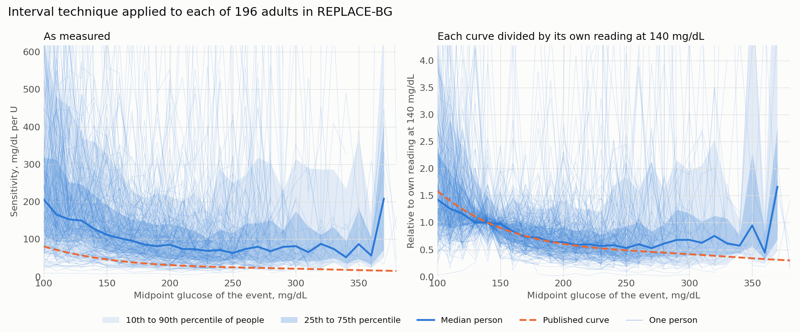

# INV-018: the interval technique applied to each person in REPLACE-BG

Generated by `inv018/person_curves.py`. Each person's curve is their median fall per unit of
insulin used above scheduled basal, over events with positive insulin used, in 10 mg/dL bins
of the event's midpoint glucose. It is an outcome ratio: an event ends where glucose stopped
falling, and simulated people with a constant sensitivity return a falling curve by the same
technique (`results/inv012_peak_trough.md`).

196 adults have a bin of 5 events between 100 and 380 mg/dL, out of 196 with any bin. They hold 100234 events, a median of 448 each, and a median of 18 bins each.

## Range across people, as measured

Sensitivity in mg/dL per U. The median carries a 95% interval over people. The last column is
the median person's share of events in the bin with no net insulin used, which the curve leaves out.

| Midpoint glucose, mg/dL | People | 10th | 25th | Median | 75th | 90th | 75th over 25th | Published | No net insulin |
|---:|---:|---:|---:|---:|---:|---:|---:|---:|---:|
| 100 | 191 | 61 | 108 | 205.8 (170.9 to 234.2) | 318 | 622 | 2.95 | 80.6 | 41% |
| 140 | 194 | 45 | 77 | 127.4 (119.5 to 150.5) | 217 | 360 | 2.82 | 50.9 | 30% |
| 180 | 190 | 37 | 57 | 85.5 (79.4 to 104.0) | 146 | 208 | 2.59 | 35.3 | 19% |
| 200 | 180 | 30 | 48 | 85.3 (73.2 to 97.7) | 142 | 215 | 2.95 | 30.8 | 17% |
| 250 | 131 | 32 | 45 | 63.0 (57.7 to 79.9) | 116 | 249 | 2.56 | 24.8 | 14% |
| 300 | 60 | 30 | 45 | 81.4 (59.8 to 100.1) | 176 | 314 | 3.92 | 21.1 | 14% |

## Range across people, each curve divided by its own reading at 140 mg/dL

The reading at 140 is the median of the person's bins from 130 to 150 mg/dL.

| Midpoint glucose, mg/dL | People | 10th | 25th | Median | 75th | 90th | 75th over 25th | Published |
|---:|---:|---:|---:|---:|---:|---:|---:|---:|
| 100 | 190 | 0.71 | 0.94 | 1.43 (1.29 to 1.59) | 2.31 | 4.04 | 2.45 | 1.59 |
| 140 | 194 | 0.74 | 1.00 | 1.00 (1.00 to 1.00) | 1.12 | 1.46 | 1.12 | 1.00 |
| 180 | 190 | 0.40 | 0.52 | 0.72 (0.66 to 0.79) | 0.93 | 1.25 | 1.80 | 0.69 |
| 200 | 180 | 0.30 | 0.45 | 0.64 (0.56 to 0.73) | 0.90 | 1.44 | 2.02 | 0.61 |
| 250 | 131 | 0.23 | 0.33 | 0.53 (0.47 to 0.69) | 0.93 | 1.85 | 2.82 | 0.49 |
| 300 | 60 | 0.19 | 0.39 | 0.68 (0.52 to 0.99) | 1.18 | 1.96 | 2.98 | 0.42 |

## By thirds of entered ISF

Readings at 140 and 250 mg/dL (bins 230 to 270), mg/dL per U. The drop and the share kept are
medians of each person's own, with 95% intervals over people.

| Entered ISF | People | Median entered | Reading at 140 | Reading at 250 | Reading at 140 over entered | Drop | Share kept |
|---|---:|---:|---:|---:|---:|---:|---:|
| Lowest third | 54 | 30 | 69 | 43 | 2.52 | 21.0 (14.4 to 39.0) | 0.58 (0.46 to 0.76) |
| Middle third | 54 | 50 | 124 | 75 | 2.78 | 52.4 (32.1 to 69.0) | 0.56 (0.49 to 0.68) |
| Highest third | 52 | 70 | 208 | 117 | 2.93 | 48.7 (42.9 to 105.8) | 0.61 (0.48 to 0.76) |

Highest third over lowest: the drop is 2.32 (1.23 to 5.51) times as large, where curves that differ by
a shift give 1. The share kept is 1.06 (0.70 to 1.45) times as large, where curves that differ by a multiple
give 1. The published curve keeps 0.49 of its value at 140 by 250 mg/dL.
