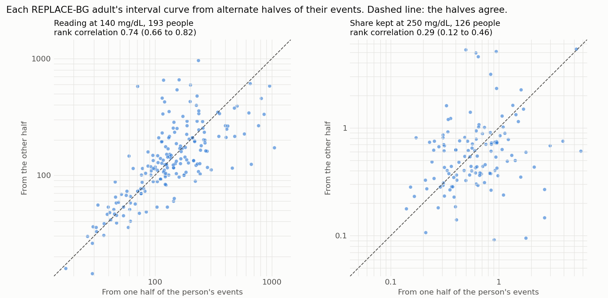

# INV-018: does a person's own interval curve repeat?

Generated by `inv018/split_half.py`. Each REPLACE-BG adult's events were split into two halves
and a curve built from each half as in `inv018/person_curves.py`. The readings are outcome
ratios (`results/inv012_peak_trough.md`), so what repeats is the measurement on that person.
Events with no net insulin used are left out of every reading, 14% to 41% of events by glucose
(`results/inv018_person_curves.md`).

196 adults, a median of 448 events each, so about 224 in a half.

The rank correlation is across people, between the two halves. The reliability on all events
steps it up by 2r / (1 + r) and is given for alternate events only. The last two columns are the
typical factor by which a prediction of the second half missed: from the person's own first half,
and from the median of everyone's first half.

## Alternate events

| Quantity | People | Rank correlation between halves | Reliability on all events | Verdict | Miss from own first half | Miss from the median first half |
|---|---:|---:|---:|---|---:|---:|
| Reading at 140 mg/dL | 193 | 0.74 (0.66 to 0.82) | 0.85 (0.79 to 0.90) | repeatable | 1.30 (1.23 to 1.42) | 1.61 (1.47 to 1.80) |
| Reading at 250 mg/dL | 128 | 0.68 (0.56 to 0.78) | 0.81 (0.72 to 0.87) | repeatable | 1.43 (1.36 to 1.53) | 1.74 (1.54 to 2.04) |
| Share kept at 190 mg/dL | 180 | 0.18 (0.03 to 0.32) | 0.30 (0.05 to 0.48) | not repeatable | 1.57 (1.43 to 1.79) | 1.37 (1.32 to 1.46) |
| Share kept at 250 mg/dL | 126 | 0.29 (0.12 to 0.46) | 0.45 (0.21 to 0.63) | undecided | 1.57 (1.43 to 1.79) | 1.59 (1.44 to 1.73) |

## Earlier and later events

| Quantity | People | Rank correlation between halves | Reliability on all events | Verdict | Miss from own first half | Miss from the median first half |
|---|---:|---:|---:|---|---:|---:|
| Reading at 140 mg/dL | 192 | 0.69 (0.59 to 0.77) | - | - | 1.44 (1.33 to 1.55) | 1.72 (1.54 to 1.91) |
| Reading at 250 mg/dL | 116 | 0.71 (0.61 to 0.79) | - | - | 1.50 (1.39 to 1.64) | 1.61 (1.50 to 1.88) |
| Share kept at 190 mg/dL | 178 | 0.21 (0.06 to 0.37) | - | - | 1.57 (1.49 to 1.76) | 1.43 (1.35 to 1.57) |
| Share kept at 250 mg/dL | 114 | 0.43 (0.26 to 0.57) | - | - | 1.58 (1.48 to 1.86) | 1.55 (1.40 to 1.71) |

A quantity is repeatable at a reliability of 0.7 or more with an interval above 0.5,
and not repeatable with an interval below 0.5. The thresholds were set before the run.
The rank correlation replaced a correlation of logs after the run, for the reason in the script.
